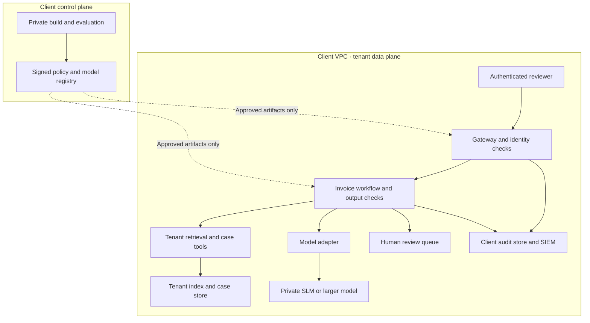
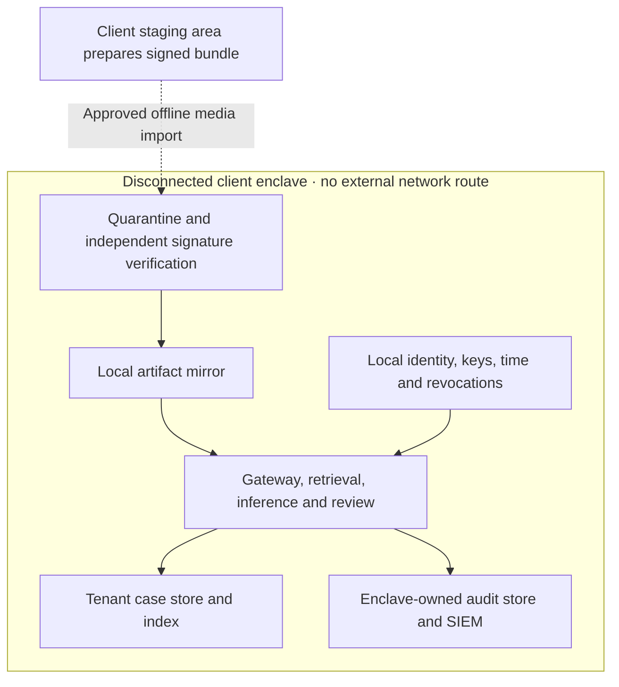

# Reference architecture and trust boundaries

The enterprise architect approves the deployment boundary before the first case enters the system. The default is client-operated inference, client-managed keys, no provider training on client data, and client-owned logs inside the same VPC or disconnected enclave. The invoice-exception workflow may return a cited draft to an authorized reviewer. The reviewer releases it through the existing business application.

## Immediate priority · Day 0–90

**Decision.** Select a client VPC when approved private network paths can carry every runtime dependency. Select a disconnected enclave when the processing environment must operate without a network path to an external administration, identity, model or telemetry service. Include backups, support access, key management and model updates in the boundary decision. Record the selected topology, asset owner and permitted flows in the release packet.

### Client VPC

The runtime pulls signed revisions through a read-only private artifact path. A separate release identity promotes revisions. Build roles cannot query case payloads. Operations staff query minimized telemetry with tenant-specific access. Use isolated tenant instances for indexes, case stores, cache partitions, encryption keys and inference workers wherever request context can persist. Authorize the user and resource on every access. [NIST SP 800-207, Zero Trust Architecture](https://www.nist.gov/publications/zero-trust-architecture)

### Disconnected enclave

Inside the enclave, validate the signer and digest against a preinstalled trust root, confirm freshness against local trusted time, and reject revoked or superseded bundles using a local revocation record. Mirror weights, tokenizer, embedding model, adapters, application image, policy, scorer and restore assets. Keep runtime logs in the enclave. The infrastructure owner rehearses a cold start and restore with all external links absent before authorizing deployment.

| Control and accountable owner | Implementation and retained evidence | Pilot pass condition | Blast radius if omitted |
|---|---|---|---|
| **ARCH-01 · Contain data and network flows.** Infrastructure owner | Deny outbound routes by default. Allow only named private dependencies. Disable provider telemetry and remote crash reporting. In the enclave, use local identity, DNS, time and key services. Reconcile network flow records with the signed diagram during steady state, startup and failure. | Zero unapproved destinations or externally exported markers in all three modes. All required local dependencies function in a cold-start rehearsal. A missing dependency holds the case. | Prompts, embeddings, logs or credentials can escape through a dependency outside the declared boundary. |
| **ARCH-02 · Isolate each tenant and user.** Data platform lead | Resolve tenant from identity and verify row-level entitlements before retrieval and again on output. Separate storage, index and encryption grants by tenant. Bind backup restoration to the destination tenant and client key. Keep semantic caching disabled for the pilot. | Across at least two synthetic tenants, every foreign case, chunk, cached value and out-of-scope restore is denied. A same-tenant reviewer lacking case access also receives zero content. Store decision counts per surface. | A single permissive index, restore role or key grant can expose a tenant's entire corpus. |
| **ARCH-03 · Authorize each tool invocation.** IAM owner | Register only `invoice_exception.read` and `policy_excerpt.read` for the pilot. At the MCP server, validate a short-lived token's issuer, audience, expiry, scope and tenant. Intersect caller rights with the worker grant and the requested case. Use a separate credential to call a downstream system. | Every wrong-audience, wrong-tenant, expired, out-of-case, unlisted-tool and invalid-argument fixture is denied before a backend call. All allowed calls fit the two-call limit. Zero runtime credentials can change the ledger. | A credential or overly broad read tool can turn one invoice review into organization-wide access. |

The Model Context Protocol (MCP) defines a transport authorization flow for HTTP and requires the server to validate the access-token audience. Tool schemas and server-side case permissions enforce the narrower workflow boundary. Bind the allowlist to an approved server identity and tool version, and reject discovery changes until reviewed. [MCP authorization specification](https://modelcontextprotocol.io/specification/2026-07-28/basic/authorization) · [MCP tools specification](https://modelcontextprotocol.io/specification/2026-07-28/server/tools)

## Ongoing priority · Day 90+

**Handoff.** Before admitting another tenant or model provider, the architecture review board receives an adapter conformance report, an independent policy promotion record and a tenant recovery exercise.

| Control and accountable owner | Implementation and retained evidence | Scale pass condition | Blast radius if omitted |
|---|---|---|---|
| **ARCH-04 · Contain vendor differences.** Platform architect | The internal adapter accepts a normalized request carrying workflow, authorized context, output schema and budget. Map permitted fields to the chosen runtime. Return decision, structured content, references, token counts, model digest and finish reason. Normalize timeout, refusal, truncation and unsupported capability to explicit workflow outcomes. | Run the same contract fixtures against every admitted adapter. All unsupported or truncated responses hold for review. No adapter can change tenant, expand tool scope, send data to another service or silently retry another model. | A backend swap changes cost, release behavior or residency without an application change. |
| **ARCH-05 · Separate policy publication from case processing.** Release engineering lead | Keep signing keys outside runtime accounts. Bind each tenant to an immutable bundle digest with validity dates. Require independent approval for replacement, plus a separately signed rollback referencing a known-good bundle. Log attempted and active revision. | Unsigned, tampered, expired and unapproved older bundles fail admission in every region or enclave. Runtime identities have zero registry write grants. A new revision can be limited to one tenant. | One compromised runtime account or stale rollout can alter enforcement for the entire fleet. |
| **ARCH-06 · Recover a tenant without crossing boundaries.** Resilience lead | Restore a tenant's encrypted snapshot, index, dependency versions, key grants and policy manifest into an isolated recovery environment. Reconcile case state against durable reviewer decisions before reopening. Repeat inside the enclave using its local mirror. | In a quarterly pilot exercise, the selected tenant resumes manual handling within 15 minutes. Restore full automated service within four hours with at most 15 minutes of source-state loss. Reconcile the recovery interval from the independent business case ledger before replay. All durable release decisions reconcile before automation resumes. Zero other tenants' records appear in the restore. | Recovery can duplicate a business action, lose its authorization trail or copy a client's data into another environment. |

These recovery objectives are proposed operating targets. The business owner sets the contracted recovery time and recovery point for each workflow. On any boundary or authorization failure, revoke the affected route and workload grants, preserve minimized evidence locally, and rerun isolation tests before reopening. [Gateway adapter contract](../04-policy-as-code-templates/ai-gateway-policy.yaml) · [Technology routing](02-technology-stack.md) · [Ongoing delivery runbook](../03-client-execution-kit/day-90-plus-ongoing-runbook.md)
