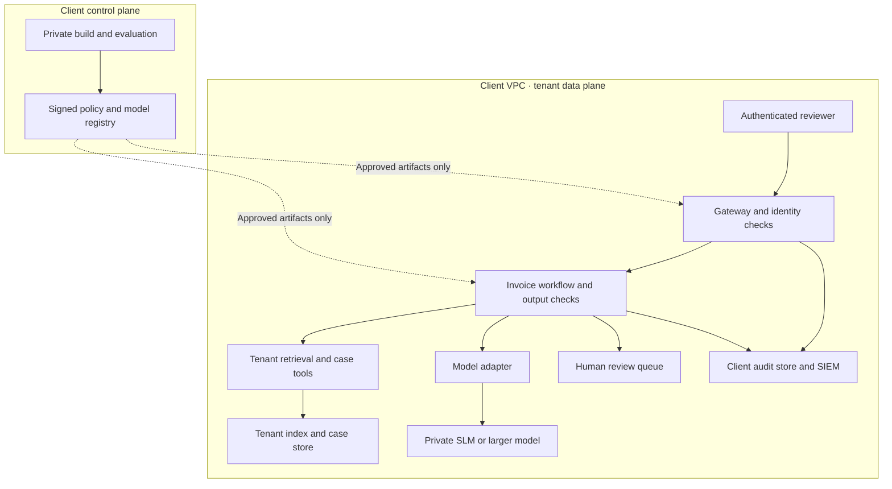
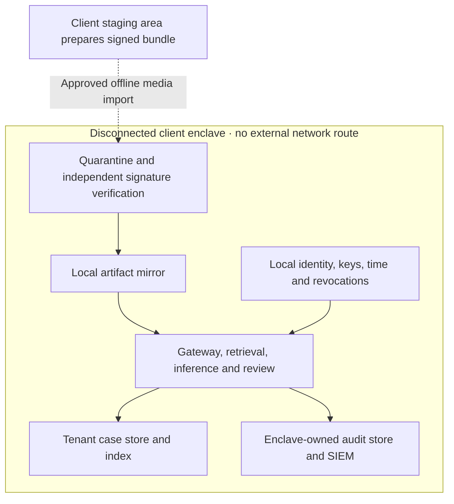

# Reference architecture and trust boundaries

Start with the invoice reviewer and follow a case through the system. The reviewer can read an assigned case, receive a cited draft and release it in the existing business application. The model needs access to private inference and two read tools. It has no reason to hold a ledger credential, a registry signing key or another tenant's case history.

The enterprise architect records the selected topology, asset owners and permitted flows before admitting the first case. In both designs, clients operate the models, manage the keys and own the logs inside the processing boundary. Third-party training on client data is prohibited.

## Immediate priority · Day 0–90

### A client virtual private cloud

Choose a virtual private cloud (VPC) when approved private paths can reach every runtime dependency. Draw the **control plane**, which builds and approves versions, separately from the **data plane**, which processes tenant cases. The same boundary covers inference with a small language model (SLM) or a larger one. Include backups, support access, keys, model updates and the security information and event management (SIEM) system when reviewing network flows.

The runtime pulls signed revisions over a read-only private path. A separate release identity approves distribution. Build roles cannot query case payloads, and operations staff see minimized telemetry for authorized tenants. Isolate indexes, case stores, cache partitions, keys and any inference worker that can retain request context by tenant. Recheck the user and resource on each access. [NIST SP 800-207, Zero Trust Architecture](https://www.nist.gov/publications/zero-trust-architecture)

### A disconnected enclave

Use the disconnected design when the environment must start, run and recover without external network access, including to identity, model, administration and telemetry services. A local mirror holds the model weights, tokenizer, embedding model, adapters, application image, policy, scoring software and restore assets.

Quarantine imported media. Verify the signer against a preinstalled trust root and the bundle against its digest. Use trusted local time and the local revocation record to reject expired, revoked or superseded bundles. Logs stay inside the enclave. The infrastructure owner rehearses cold startup and restoration with external links absent.

### ARCH-01 · Account for every network destination

Deny outbound routes by default. Allow named private dependencies, disable provider telemetry and remote crash reporting, and supply local identity, name resolution, time and keys in the enclave. The infrastructure owner compares actual flow records with the signed diagram during startup, steady operation and failure. Require **zero unapproved destinations and zero externally exported test markers** in all three modes. Every required local dependency must function from a cold start. A missing dependency holds the case. A crash reporter that runs only during failure can otherwise send credentials or model inputs across the boundary.

### ARCH-02 · Test two tenants and two levels of access

The data platform lead derives the tenant from verified identity, checks case-level rights before retrieval and again on output, and assigns storage, index and encryption grants per tenant. Bind restores to the destination tenant and client key. Keep semantic caching off for the pilot.

With at least **two synthetic tenants**, verify that each foreign case, passage, cached value and out-of-scope restore is denied. Include a reviewer in the correct tenant who lacks access to this case. That reviewer must receive zero content. Retain decision counts for each access path. A permissive restore role or index grant can expose a whole corpus even if the application passes its ordinary access checks.

### ARCH-03 · Enforce the reader's rights at the tool server

The identity and access management owner registers only `invoice_exception.read` and `policy_excerpt.read`. The Model Context Protocol (MCP) server validates the short-lived token's issuer, audience, expiry, scope and tenant. Restrict each call to the intersection of the caller's rights, the worker grant and the requested case. Use a separate credential for downstream access. Pin the approved server and tool version, and review any change advertised by tool discovery. [MCP authorization specification](https://modelcontextprotocol.io/specification/2026-07-28/basic/authorization) · [MCP tools specification](https://modelcontextprotocol.io/specification/2026-07-28/server/tools)

Exercise wrong-audience, wrong-tenant, expired, out-of-case, unlisted-tool and invalid-argument requests. All must stop before a backend call. Allow at most **two tool calls per request**, with zero runtime credentials capable of changing the ledger. A generic read credential can otherwise turn permission to review one invoice into permission to read thousands.

## Ongoing priority · Day 90+

### ARCH-04 · Qualify a new model adapter

The platform architect defines the contract between the workflow and each model runtime. The adapter accepts workflow, authorized context, permitted output structure and budget. It returns the decision, structured content, references, token counts, model digest and completion reason. Translate timeout, refusal, truncation and unsupported operations into explicit workflow outcomes.

Run identical contract tests against every adapter and retain the comparison. Unsupported or truncated results must go to review. No adapter may change tenant, expand tool scope, send data to another service or silently retry a different model. A provider change can otherwise alter residency, cost or release behavior without a change to the business application.

### ARCH-05 · Keep policy signing outside case processing

Release Engineering keeps signing keys outside runtime accounts and binds each tenant to an immutable bundle digest and validity period. Require independent approval for replacements. For rollback, sign a separate instruction naming the previously approved bundle. Record attempted and active revisions.

Every region or enclave must reject unsigned, altered, expired and unapproved older bundles. Runtime identities must have zero registry write grants. Demonstrate a release that changes one tenant alone and retain the promotion record. Sharing a signing role with inference would let one affected worker change enforcement across the fleet.

### ARCH-06 · Restore one tenant and reconcile the missing interval

Each quarter the resilience lead restores one tenant's encrypted snapshot, index, dependency versions, key grants and policy manifest into an isolated environment. For an enclave, restore from its local mirror. Retain the rehearsal record. The pilot target is **manual handling within 15 minutes**, **full automation within four hours** and **at most 15 minutes of source-state loss**. The business owner agrees the contracted recovery targets for each workflow.

Before replaying work, reconcile that interval against the independent business case ledger. Every durable release decision must be accounted for before automation resumes, and zero records from other tenants may appear in the restore. Restoring a snapshot from before an approval can otherwise cause a business action to run twice.

On a boundary or authorization failure, revoke the affected route and workload grants, preserve minimized evidence in the client environment and rerun isolation tests before reopening. The architecture review board examines the adapter comparison, promotion record and recovery drill before approving another tenant or provider. [Gateway adapter contract](../04-policy-as-code-templates/ai-gateway-policy.yaml) · [Technology routing](02-technology-stack.md) · [Ongoing delivery runbook](../03-client-execution-kit/day-90-plus-ongoing-runbook.md)
